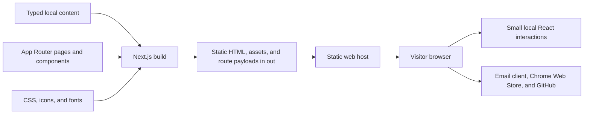

# High-level design

CodeCube99 is a static portfolio for a software generalist and independent builder. The site presents two browser extensions, explains the author's approach, collects notebook drafts, and gives visitors direct ways to reach the author or open a product listing.

The visual direction expresses precision through an editorial grid, oversized sans-serif headings, occasional italic serif emphasis, graphite and paper surfaces, and a restrained orange accent. A layered, interactive CSS cube gives the homepage its own identity. Motion supports orientation and discovery; the content remains useful without it.

For implementation details, see [LLD.md](./LLD.md). For the development and agent workflow, see [CONTRIBUTING.md](./CONTRIBUTING.md) and [AGENTS.md](./AGENTS.md).

## Scope and provenance

The user supplied `claude-design-99.zip`, a set of HTML design references, scripts, and assets. Its named references include `CodeCube Cube.dc.html`, `CodeCube Grid.dc.html`, `CodeCube Paper.dc.html`, `PixelGhost.dc.html`, and the `codecube99` variants. The archive is a design and content reference, not an application dependency. Preserve it as the source artifact.

[scroll-craft](https://github.com/nateherkai/scroll-craft) was supplied as light inspiration for considered scrolling and progressive disclosure. The application uses browser-native CSS and React; it does not depend on scroll-craft or an animation framework. Any later reuse of third-party code requires checking its license and retaining applicable attribution.

Content must remain honest about its origin and status:

- Product names, author contact details, store links, and supplied descriptions form the initial content baseline in `lib/content.ts`.
- The product miniatures are explicitly labelled interactive concepts. They illustrate an interaction; they are not screenshots, live extension sessions, or evidence of actual product internals.
- The archive provides notebook titles and excerpts, not complete article bodies. Detail routes identify these notes as work in progress and emit `noindex, follow` metadata.
- Do not invent employment history, a downloadable résumé, customer metrics, endorsements, article bodies, or product claims to fill a visual gap.
- PixelGhost privacy and support content must stay consistent with the supplied product material and verified implementation. A portfolio redesign does not establish a new data policy for the extension.

## System structure

The build renders page content ahead of time. A static host serves the exported output, and small client components add interactivity after hydration. There is no application backend, database, authentication service, CMS, analytics client, contact submission endpoint, or server-side session.

Contact actions use `mailto:`. Product installation and source actions use ordinary external links. Opening those destinations is separate from running the portfolio; their availability is controlled by the destination service.

## Technical baseline

| Layer                | Choice                                                  | Responsibility                                                      |
| -------------------- | ------------------------------------------------------- | ------------------------------------------------------------------- |
| Framework            | Next.js `16.3.4`, App Router                            | Page composition, metadata, static rendering, and client navigation |
| UI                   | React and React DOM `19.2.8`                            | Components and small local interaction states                       |
| Language             | TypeScript, strict mode                                 | Route and component contracts                                       |
| Styling              | Tailwind CSS 4 import plus authored `app/globals.css`   | Tokens, layout, artwork, motion, and responsive variants            |
| Typography           | Geist, Geist Mono, Instrument Serif through `next/font` | Sans, technical labels, and italic accents                          |
| Package manager      | pnpm `12.3.4`                                           | Reproducible dependency installation through `pnpm-lock.yaml`       |
| Development baseline | Node.js `24.20.0`                                       | Version used by the redesign environment                            |
| Delivery             | `output: "export"`, `trailingSlash: true`               | Static directory output; no production Next.js server required      |

`next/font/google` resolves fonts during the build and emits assets served from the site itself. A fresh build may need network access to obtain fonts; visitors do not need browser requests to Google for these font files. If offline builds become a requirement, commit appropriately licensed font files and switch to `next/font/local`.

## Information architecture

| Route                           | Purpose                                                               | Source                               |
| ------------------------------- | --------------------------------------------------------------------- | ------------------------------------ |
| `/`                             | Introduction, selected work, approach, notebook preview, contact      | Profile, projects, notes, and traits |
| `/products/pixelghost/`         | PixelGhost overview, illustrative demo, features, and product actions | Matching `projects` entry            |
| `/products/youscroll/`          | You'Scroll overview, illustrative demo, features, and product actions | Matching `projects` entry            |
| `/products/pixelghost/privacy/` | Supplied PixelGhost privacy information                               | Dedicated page content               |
| `/products/pixelghost/support/` | PixelGhost help and contact paths                                     | Dedicated page content               |
| `/journal/`                     | Notebook directory with tag filters                                   | `notes`                              |
| `/journal/[slug]/`              | A supplied excerpt and a clear draft notice                           | Matching `notes` entry               |

Products and notebook entries use dynamic route folders for maintainability, but every supported slug is enumerated at build time. An unknown slug is a 404, never a request for an on-demand server render. Home section anchors are stable navigation contracts: `work`, `approach`, `journal`, and `contact`. Every content route provides `main-content` as the skip-link target.

## Component boundaries

The root layout owns typography, global CSS, site metadata defaults, and the shared header/footer. Page modules own route-specific headings, content hierarchy, and metadata. `lib/content.ts` is the shared source for product cards, product routes, notebook previews, and notebook detail routes.

Client behavior is limited to the shared header, cube interaction, product concepts, and notebook filtering. Static content should remain in server-rendered page modules. `"use client"` is a dependency boundary; adding it to an entire page unnecessarily increases what the browser must load.

| Interaction             | State or mechanism                                                | Lifetime                                   |
| ----------------------- | ----------------------------------------------------------------- | ------------------------------------------ |
| Mobile menu             | React boolean; Escape closes and restores focus                   | Shared header mount                        |
| Theme                   | External preference store and `html[data-theme]`                  | Local storage, with a current-tab fallback |
| Decorative motion pause | External preference store and `html[data-motion]`                 | Local storage, with a current-tab fallback |
| Reading progress        | Scroll/resize listeners, animation-frame scheduling, CSS property | Rebound on route changes                   |
| Cube                    | Assemble/explode state; pointer coordinates as CSS properties     | Cube mount                                 |
| PixelGhost concept      | Overlay visibility toggle                                         | Demo mount                                 |
| You'Scroll concept      | Native scrolling in the comments region                           | Demo mount                                 |
| Notebook filter         | Selected tag and derived visible entries                          | Notebook component mount                   |
| Support answers         | Native `details`/`summary`                                        | Browser-managed page state                 |

Theme and motion preferences use the local-storage keys `cc99-theme` and `cc99-motion`. They survive navigation and reloads when storage is available, and synchronize across tabs through browser storage events. If storage is blocked, an in-memory fallback keeps the current tab functional. No cookie or server record is created. Static HTML uses dark/full-motion defaults. A guarded pre-paint script restores saved root attributes before the page is painted; the client store then synchronizes the controls. The system reduced-motion rule applies through CSS immediately.

## Design and accessibility contracts

Color and typography decisions are centralized in CSS variables. Global theme colors are semantic; local product artwork may use its own deliberate palette. The page alternates dark and paper chapters, with the same spacing and typographic grammar across home and detail routes.

Responsive behavior preserves hierarchy rather than shrinking the desktop layout indefinitely. The hero becomes one column on narrow screens, product cards stack, navigation becomes a disclosure, and nonessential micro-labels may disappear. Product descriptions, controls, contact paths, and route navigation remain available.

The baseline includes semantic landmarks, one principal heading per route, visible keyboard focus, a skip link, labelled controls, state expressed with ARIA attributes, and usable native scrolling. Essential interactions use buttons and links rather than pointer-only elements. `prefers-reduced-motion` and the visible pause control disable decorative transitions and entrance effects. Unsupported scroll timelines fall back to fully visible content.

These are implementation requirements, not an assertion of formal accessibility certification. Verify both themes, keyboard use, narrow layouts, and motion preferences when changing the relevant behavior.

## Performance and delivery

The signature artwork is made from CSS and SVG, avoiding video, a WebGL runtime, and a large raster hero. Scroll-linked reveals use a feature-tested CSS view timeline. Reading progress batches DOM updates through `requestAnimationFrame`; its listeners are cleaned up when the effect reruns or unmounts.

Production builds write the complete site to `out/`. Serve that directory with a static host that resolves directory indexes and uses the exported 404 page for missing routes. Deep links must work when opened directly, not only after client navigation. `pnpm start` runs the repository's local static preview server, `scripts/serve.mjs`, against `out/`. It does not run `next start`, which is not the preview mechanism for an exported site.

No production domain is assumed. Add canonical URLs, a domain-specific sitemap, or social sharing URLs only after the owner supplies the intended deployment address. Publishing and domain configuration are separate operational steps from producing a verified build.

## Validation and evolution

The required automated baseline is `pnpm lint`, `pnpm build`, and `pnpm check:export`. Next.js 16 does not run lint as part of the build. The export checker described in [LLD.md](./LLD.md) verifies generated documents, local links and assets, draft metadata, and product destinations. Browser verification covers interactive behavior and visual quality that static checks cannot establish.

Adding a product or note begins in the typed content source and ends with a rebuilt export. Adding server actions, authenticated content, form processing, remote editing, or request-specific rendering changes this architecture and requires updating both design documents and the delivery model. Keep those changes explicit rather than hiding a service dependency inside a visual component.
