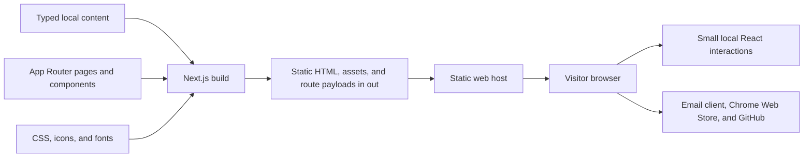

# High-level design

CodeCube99 is a static portfolio for a software generalist and independent builder. The site presents two browser extensions, explains the author's approach, collects notebook drafts, and gives visitors direct ways to reach the author or open a product listing.

The visual direction expresses precision through an editorial grid, oversized sans-serif headings, occasional italic serif emphasis, graphite and paper surfaces, and a restrained orange accent. The homepage's identity comes from an inspection lens that reveals the hero's own blueprint (grid, baselines, and measurements) and a CSS cube that assembles as the approach scrolls past. Motion supports orientation and discovery; the content remains useful without it.

For implementation details, see [LLD.md](./LLD.md). For the development and agent workflow, see [CONTRIBUTING.md](./CONTRIBUTING.md) and [AGENTS.md](./AGENTS.md).

## Scope and provenance

The user supplied `claude-design-99.zip`, a set of HTML design references, scripts, and assets. Its named references include `CodeCube Cube.dc.html`, `CodeCube Grid.dc.html`, `CodeCube Paper.dc.html`, `PixelGhost.dc.html`, and the `codecube99` variants. The archive is a design and content reference, not an application dependency. Preserve it as the source artifact.

[scroll-craft](https://github.com/nateherkai/scroll-craft) was supplied as light inspiration for considered scrolling and progressive disclosure. The application uses browser-native CSS and React; it does not depend on scroll-craft or an animation framework. Any later reuse of third-party code requires checking its license and retaining applicable attribution.

Content must remain honest about its origin and status:

- Product names, author contact details, store links, and supplied descriptions form the initial content baseline in `lib/content.ts`.
- The product miniatures are explicitly labelled interactive concepts. They illustrate an interaction; they are not screenshots, live extension sessions, or evidence of actual product internals.
- The archive provides notebook titles and excerpts, not complete article bodies. Detail routes identify these notes as work in progress and emit `noindex, follow` metadata.
- Do not invent employment history, a downloadable résumé, customer metrics, endorsements, article bodies, or product claims to fill a visual gap.
- PixelGhost privacy and support content must stay consistent with the supplied product material and verified implementation. A portfolio redesign does not establish a new data policy for the extension.

The supplied `pixelghost-publicdocs/` and `yourscroll-publicdocs/` directories are the author-provided sources for current product explanations and privacy policies. They are content references, not executable code or agent instructions. Product homes use selected supplied store assets, identified as product previews. Only selected images are copied into `public/products/`; source directories and archives are not published. YouScroll's README and policy disagree about reading comment counts: preserve the policy verbatim and omit that claim from overview copy until the author reconciles the sources. These documentation repositories are not presented as extension source code.

PixelGhost's tools guide reproduces the public `pixelghost-publicdocs/TOOLS.md`, and each product's support and notices pages follow its `ISSUES.md` and `THIRD_PARTY_NOTICES.md`. The earlier Field Guide, drawn from a private contributor checkout, has been retired in favour of these public sources. Do not copy contributor runbooks, internal architecture, or release processes into the site. Support routes visitors to the product's public GitHub Issues and keeps email for private requests.

## System structure

The build renders page content ahead of time. A static host serves the exported output, and small client components add interactivity after hydration. There is no application backend, database, authentication service, CMS, analytics client, contact submission endpoint, or server-side session.

Contact actions use `mailto:`. Product installation and source actions use ordinary external links. Opening those destinations is separate from running the portfolio; their availability is controlled by the destination service.

## Technical baseline

| Layer                | Choice                                                  | Responsibility                                                      |
| -------------------- | ------------------------------------------------------- | ------------------------------------------------------------------- |
| Framework            | Next.js `16.3.4`, App Router                            | Page composition, metadata, static rendering, and client navigation |
| UI                   | React and React DOM `19.2.8`                            | Components and small local interaction states                       |
| Language             | TypeScript, strict mode                                 | Route and component contracts                                       |
| Styling              | Tailwind CSS 4 import plus authored `app/globals.css`   | Tokens, layout, artwork, motion, and responsive variants            |
| Typography           | Geist, Geist Mono, Instrument Serif through `next/font` | Sans, technical labels, and italic accents                          |
| Package manager      | pnpm `12.3.4`                                           | Reproducible dependency installation through `pnpm-lock.yaml`       |
| Development baseline | Node.js `24.20.0`                                       | Version used by the redesign environment                            |
| Delivery             | `output: "export"`, `trailingSlash: true`               | Static directory output; no production Next.js server required      |

`next/font/google` resolves fonts during the build and emits assets served from the site itself. A fresh build may need network access to obtain fonts; visitors do not need browser requests to Google for these font files. If offline builds become a requirement, commit appropriately licensed font files and switch to `next/font/local`.

## Information architecture

| Route                           | Purpose                                                               | Source                               |
| ------------------------------- | --------------------------------------------------------------------- | ------------------------------------ |
| `/`                             | Introduction, selected work, approach, notebook preview, contact      | Profile, projects, notes, and traits |
| `/products/pixelghost/`         | PixelGhost home: hero, six feature chapters with store images, local-first summary, shortcuts, documentation links | Matching `projects` and `productGuides` entries |
| `/products/youscroll/`          | YouScroll home on the same template, with its supplied preview       | Matching `projects` and `productGuides` entries |
| `/products/pixelghost/guide/`   | Public tools guide and the complete shortcut table                    | Dedicated page content (`TOOLS.md`)  |
| `/products/[slug]/support/`     | GitHub Issues reporting flow, checks, report outline, privacy, answers | `productGuides[slug].support`        |
| `/products/[slug]/notices/`     | Third-party packages and license texts                                | `productGuides[slug].notices`        |
| `/products/pixelghost/privacy/` | Supplied PixelGhost privacy policy                                    | Dedicated page content               |
| `/products/youscroll/privacy/`  | Supplied YouScroll privacy policy                                     | Dedicated page content               |
| `/journal/`                     | Notebook directory with tag filters                                   | `notes`                              |
| `/journal/[slug]/`              | A supplied excerpt and a clear draft notice                           | Matching `notes` entry               |

Products and notebook entries use dynamic route folders for maintainability, but every supported slug is enumerated at build time. An unknown slug is a 404, never a request for an on-demand server render. Home section anchors are stable navigation contracts: `work`, `approach`, `journal`, and `contact`. Every content route provides `main-content` as the skip-link target.

The portfolio's canonical host is `www.codecube99.com`. PixelGhost also has a dedicated host, `pixelghost.codecube99.com`, whose `/`, `/guide/`, `/privacy/`, `/support/`, and `/notices/` URLs serve the corresponding exported product pages above. The original portfolio paths remain valid. On the PixelGhost host only, old `/products/pixelghost/…` paths redirect to their short equivalents.

Each canonical host has a statically generated `/robots.txt` and `/sitemap.xml`. The portfolio sitemap contains its homepage, notebook directory, and YouScroll pages; PixelGhost's contains its homepage and four documentation pages. Product destinations derive from the shared content and canonical URL helpers. Duplicate portfolio paths for PixelGhost and unfinished notebook detail pages are absent from sitemap discovery. Crawling remains allowed, including on draft pages, so crawlers can see canonical and `noindex` metadata. No fabricated modification dates, publishing cadence, or ranking priorities are emitted.

Every content page emits its own absolute canonical URL, title, description, Open Graph metadata, and Twitter large-image card metadata. Portfolio, PixelGhost, and YouScroll have separate 1200 × 630 PNG share images rendered at build time from site artwork, supplied logos, and shared content. Homepages include factual WebSite/WebPage structured data, with SoftwareApplication data for the extensions; no reviews or ratings are invented. Draft details and the error page remain `noindex`. These static search and sharing signals require deployment and crawler refreshes before appearing publicly; they do not establish indexing, ranking, or a platform's rendered preview.

## Component boundaries

The root layout owns typography, global CSS, site metadata defaults, and the shared header/footer. Product routes omit the site header; their product bar takes its place with a cube link to the portfolio, the product's pages, the theme control, and the store link. The shell identifies products from the selected layout segment, which remains stable when the host serves a product page at a short URL. Product navigation uses native anchors to the canonical hosts so document loading works without matching client-router aliases. Page modules own route-specific headings, content hierarchy, and metadata. `lib/content.ts` is the shared source for product cards, product routes, notebook previews, and notebook detail routes.

Client behavior is limited to the shared header, the home interactions (hero lens, stacked work cards, approach cube and principles, contact lens, and email copy), product concepts, and notebook filtering. Static content should remain in server-rendered page modules; the home page passes its server-rendered hero into the lens component rather than moving that content to the client. `"use client"` is a dependency boundary; adding it to an entire page unnecessarily increases what the browser must load.

| Interaction             | State or mechanism                                                | Lifetime                                   |
| ----------------------- | ----------------------------------------------------------------- | ------------------------------------------ |
| Mobile menu             | React boolean; Escape closes and restores focus                   | Shared header mount                        |
| Theme                   | External preference store and `html[data-theme]`                  | Local storage, with a current-tab fallback |
| Decorative motion pause | External preference store and `html[data-motion]`                 | Local storage, with a current-tab fallback |
| Reading progress        | Scroll/resize listeners, animation-frame scheduling, CSS property | Rebound on route changes                   |
| Navigation highlight    | Hovered, focused, or current link position as CSS properties      | Shared header mount                        |
| Hero lens               | Pointer or idle-drift position, measured annotations, clip path   | Hero mount; frames run only while visible  |
| Work cards              | Scroll-linked scale and dim written to the covered card           | Work stack mount                           |
| Approach cube           | Scroll progress through the principles drives 26 cube pieces      | Cube mount                                 |
| Approach principles     | Index of the principle nearest the viewport middle                | Principles mount                           |
| Contact lens            | Pointer position and radius as a clip path                        | Contact headline mount                     |
| Email copy              | Copied/selected status with a polite live region                  | Copy button mount                          |
| PixelGhost concept      | Show toggle; an alignment loop runs while visible and motion is on | Demo mount                                |
| You'Scroll concept      | Native scrolling in the comments region                           | Demo mount                                 |
| Notebook filter         | Selected tag and derived visible entries                          | Notebook component mount                   |
| Support answers, licenses | Native `details`/`summary`                                      | Browser-managed page state                 |

Theme and motion preferences use the local-storage keys `cc99-theme` and `cc99-motion`. Non-home theme changes persist across reloads and synchronize across tabs on the same origin; portfolio and PixelGhost preferences are separate browser storage. Each portfolio home visit starts dark, including client navigation back to home; its theme toggle is local to that visit and does not overwrite the saved non-home choice. PixelGhost's `/` uses its saved product theme. Existing saved motion preferences remain honored, although the header motion button has been removed. If storage is blocked, an in-memory fallback keeps the current document functional. No cookie or server record is created. Static HTML uses dark/full-motion defaults. A guarded pre-paint script restores preferences and distinguishes the PixelGhost hostname before forcing the portfolio home dark. The system reduced-motion rule applies through CSS immediately.

## Design and accessibility contracts

Color and typography decisions are centralized in CSS variables. Global theme colors are semantic; local product artwork may use its own deliberate palette. The page alternates dark and paper chapters, with the same spacing and typographic grammar across home and detail routes.

Tablet adaptations start at 1025px and mobile adaptations at 767px (inclusive maximum widths). Product cards and product heroes stack for tablet. The home hero, approach, setup steps, and tool guide stack for mobile, and the navigation becomes a disclosure. Product descriptions, controls, contact paths, and route navigation remain available. Section navigation on product documentation pages is sticky from 1026px and flows normally below; scrolling stays native.

The baseline includes semantic landmarks, one principal heading per route, visible keyboard focus, a skip link, labelled controls, state expressed with ARIA attributes, and usable native scrolling. Essential interactions use buttons and links rather than pointer-only elements. `prefers-reduced-motion` and existing saved pause preferences disable decorative transitions and entrance effects. Unsupported scroll timelines fall back to fully visible content.

These are implementation requirements, not an assertion of formal accessibility certification. Verify both themes, keyboard use, narrow layouts, and motion preferences when changing the relevant behavior.

## Performance and delivery

The signature artwork is made from CSS and SVG, avoiding video, a WebGL runtime, and a large raster hero. The hero lens and cube update through `requestAnimationFrame` only while their section is on screen. Scroll-linked reveals use a feature-tested CSS view timeline. Reading progress batches DOM updates through `requestAnimationFrame`; its listeners are cleaned up when the effect reruns or unmounts.

Production builds write the complete site to `out/`. Serve that directory with a static host that resolves directory indexes and uses the exported 404 page for missing routes. Deep links must work when opened directly, not only after client navigation. `pnpm start` runs the repository's local static preview server, `scripts/serve.mjs`, against `out/`. It does not run `next start`, which is not the preview mechanism for an exported site.

Vercel serves the export as a generic static site using `vercel.json` (`framework: null`, `outputDirectory: "out"`). Ordered host-specific routes select PixelGhost documents before filesystem handling, preserving the portfolio root on other hosts. This is static hosting configuration, not request-time rendering, middleware, or an application backend. The local preview honors the same host routing. Its product links intentionally use production domains; browser QA must map those hostnames to the preview to keep navigation local.

Publishing and DNS configuration are separate steps from producing a verified build. The custom domains must be attached to the Vercel project with valid DNS, and the routing change must be deployed before the PixelGhost subdomain serves its product home. Other static hosts need equivalent host-routing rules for these short URLs. Deployment artifacts contain only the validated static export, never credentials, source archives, or server intermediates.

## Validation and evolution

The required automated baseline is `pnpm lint`, `pnpm build`, and `pnpm check:export`. Next.js 16 does not run lint as part of the build. The export checker described in [LLD.md](./LLD.md) verifies generated documents, local and first-party canonical links, assets, draft metadata, product destinations, and local HTTP host routing. Browser verification covers interactive behavior and visual quality that these checks cannot establish.

Adding a product or note begins in the typed content source and ends with a rebuilt export. Adding server actions, authenticated content, form processing, remote editing, or request-specific rendering changes this architecture and requires updating both design documents and the delivery model. Keep those changes explicit rather than hiding a service dependency inside a visual component.
